# Potret NPC Vanillate Story

40 potret anime visual novel, sesuai kode dan nama berkas di `../manifest.csv`.

- Format: WebP, 768×1024 (3:4), masing-masing di bawah 250 KB.
- Dibuat dengan OpenAI image generation pada 14 November 2026.
- Bentuk wajah, mata, hidung, rahang, usia, dan rambut divariasikan per karakter.
- PNG asli tetap disimpan di workspace pembuatan dan tidak dimasukkan ke repositori.

| Kode | Karakter | Potret |
|---|---|---|
| ST-NPC-001 | Pak Arman (Pemilik kontrakan) |  |
| ST-NPC-002 | Bu Siti (Pemilik warung) |  |
| ST-NPC-003 | Pak Hasan (Kepala bengkel) |  |
| ST-NPC-004 | Dokter Raka (Dokter klinik) |  |
| ST-NPC-005 | Alya (Pelukis muda) | 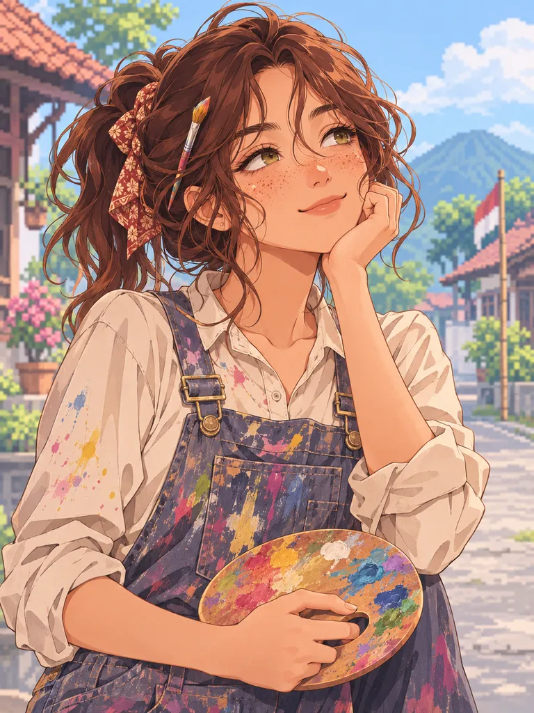 |
| ST-NPC-006 | Siska (Perawat dan calon dokter) |  |
| ST-NPC-007 | Rina (Penjual di toko) |  |
| ST-NPC-008 | Pak Rudi (Nelayan senior) | 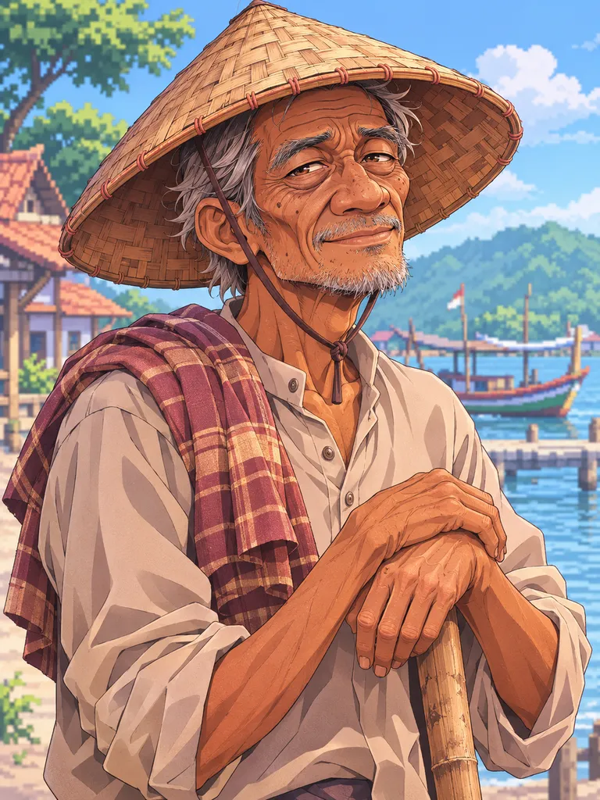 |
| ST-NPC-009 | Mira (Guru sekolah) |  |
| ST-NPC-010 | Pak Surya (Kepala desa) | 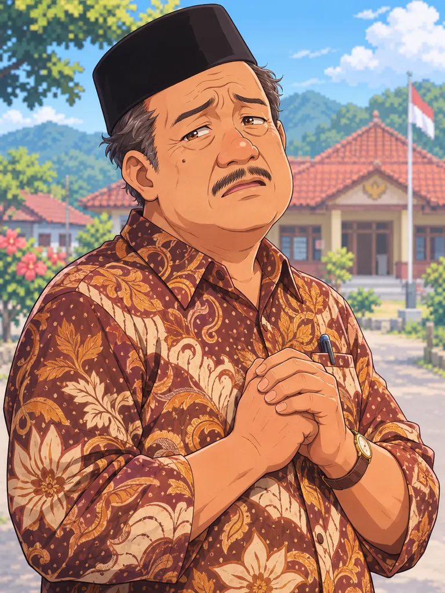 |
| ST-NPC-011 | Rio (Pemuda pengangguran) |  |
| ST-NPC-012 | Bu Yanti (Ibu kos tetangga) | 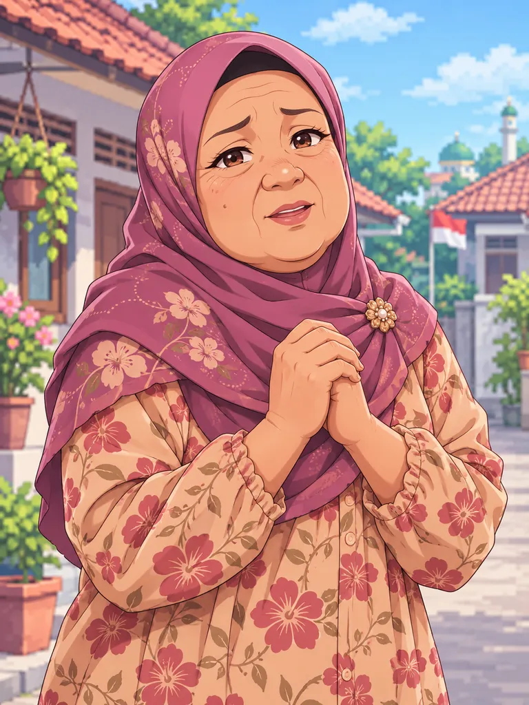 |
| ST-NPC-013 | Anggun Safitri (Penjual bunga) | 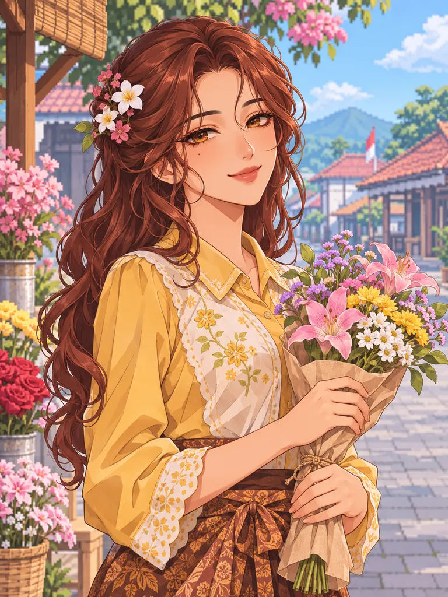 |
| ST-NPC-014 | Suciasih (Arwah penunggu kuburan) |  |
| ST-NPC-015 | Tatang Suratang (Penjual sate keliling) |  |
| ST-NPC-016 | Atep Lexmana (Pemilik toko Urban Streetwear) |  |
| ST-NPC-017 | Imas Nurullatifa (Perawat klinik) |  |
| ST-NPC-018 | Indah Putri Savitri (Perawat klinik) |  |
| ST-NPC-019 | Dr. Dimas Taufik (Dokter klinik) |  |
| ST-NPC-020 | Djoko Seno (Sesepuh dan investor kota) | 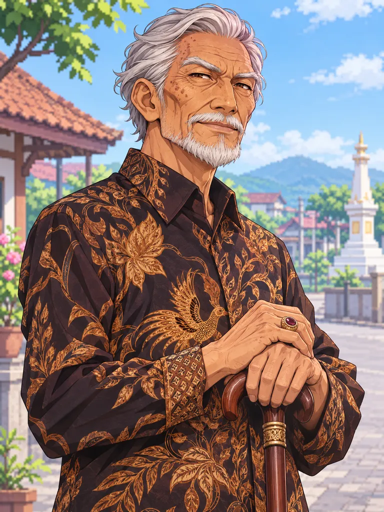 |
| ST-NPC-021 | Lelasari (Pemilik kos) | 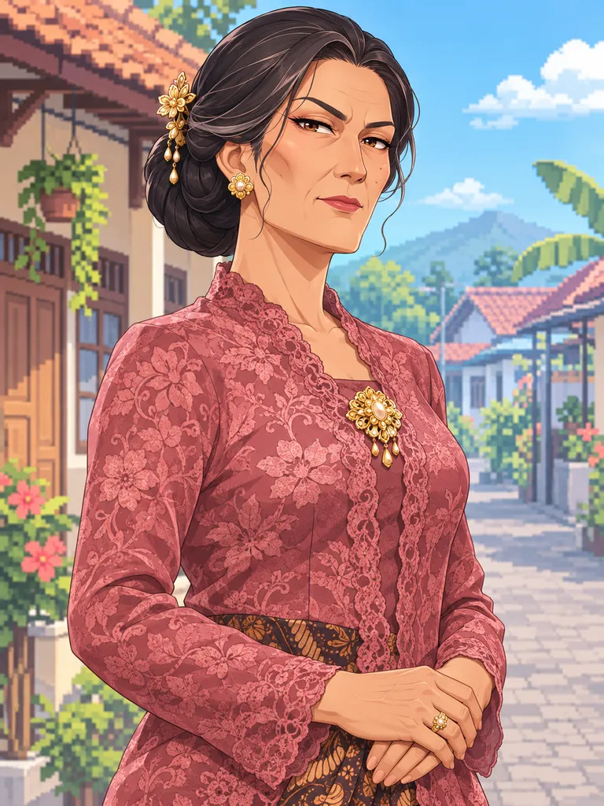 |
| ST-NPC-022 | Isma Nur Ainnisa (Kasir Toko Serba Ada) |  |
| ST-NPC-023 | Nabila Resyaliani (Kasir Toko Serba Ada) |  |
| ST-NPC-024 | Windy Lestari (Kasir minimarket dan atlet) |  |
| ST-NPC-025 | Annissa Lavika (Guru SD) | 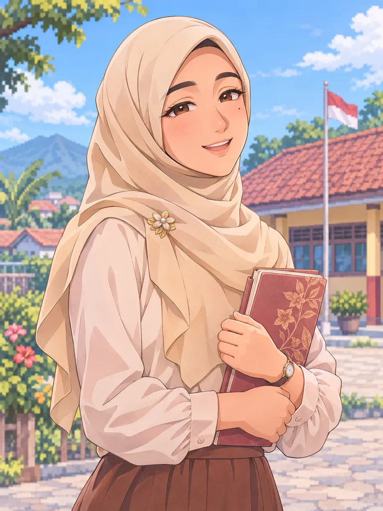 |
| ST-NPC-026 | Seno Suryo (Guru SD dan penulis) |  |
| ST-NPC-027 | Shelli Nurahman (Murid SD) |  |
| ST-NPC-028 | Lina Lesmana (Murid SD) |  |
| ST-NPC-029 | Rara Anindra (Murid SD) |  |
| ST-NPC-030 | Tigor S. (Pelatih gym) |  |
| ST-NPC-031 | Arpat Firman (Pemilik warnet) | 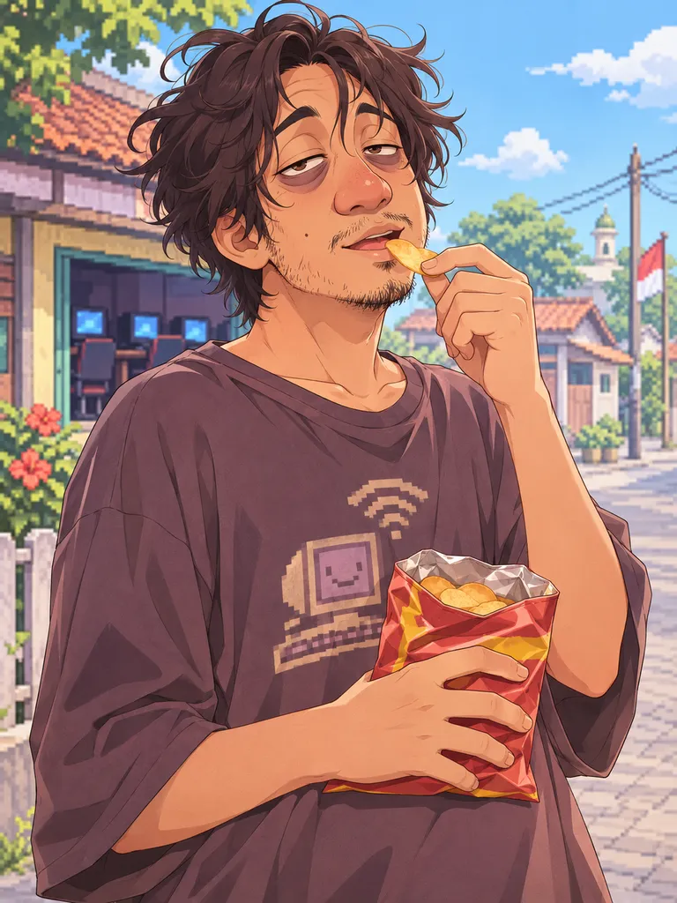 |
| ST-NPC-032 | Citra Amalia Putri (Kasir restoran) |  |
| ST-NPC-033 | Jessica Althanissa (Kasir restoran) |  |
| ST-NPC-034 | Tasya Wulandari (Kasir dan penulis pemalu) |  |
| ST-NPC-035 | Tuti Mutia (Pemilik kos) | 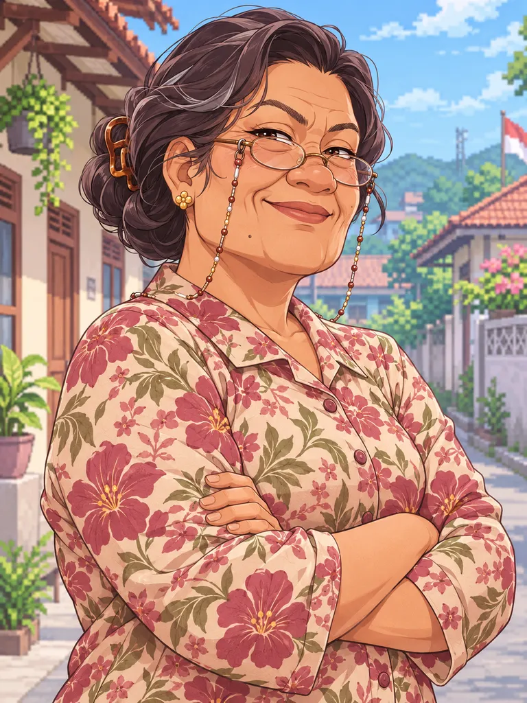 |
| ST-NPC-036 | Tio Nurcahyo (Kurir online) |  |
| ST-NPC-037 | Bang Jul (Rentenir dari kampung) | 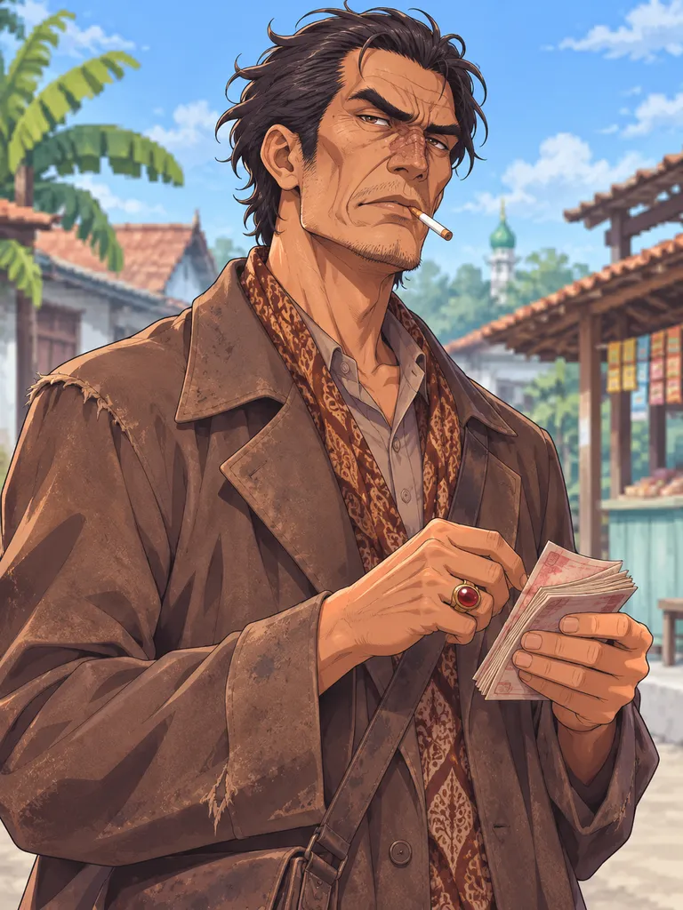 |
| ST-NPC-038 | Ibu (Ibu pemain) | 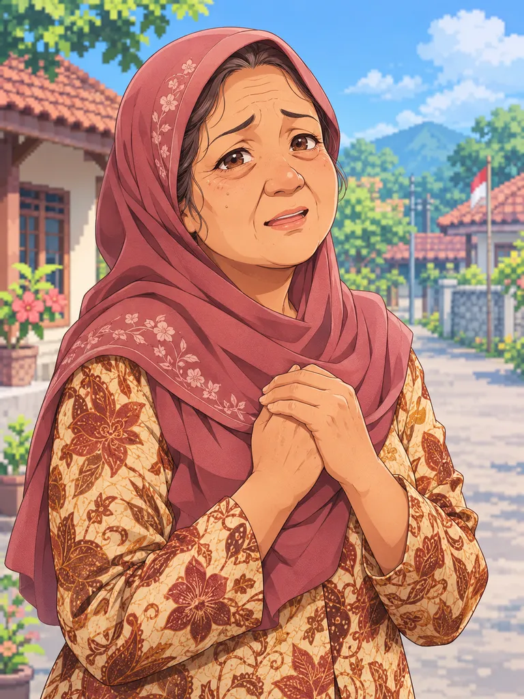 |
| ST-NPC-039 | Bapak (Ayah pemain, sakit) | 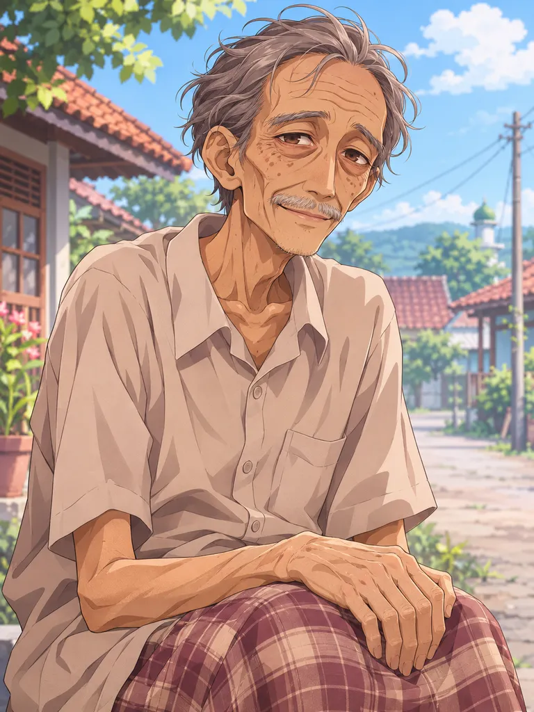 |
| ST-NPC-040 | Sari (Adik perempuan pemain) |  |
